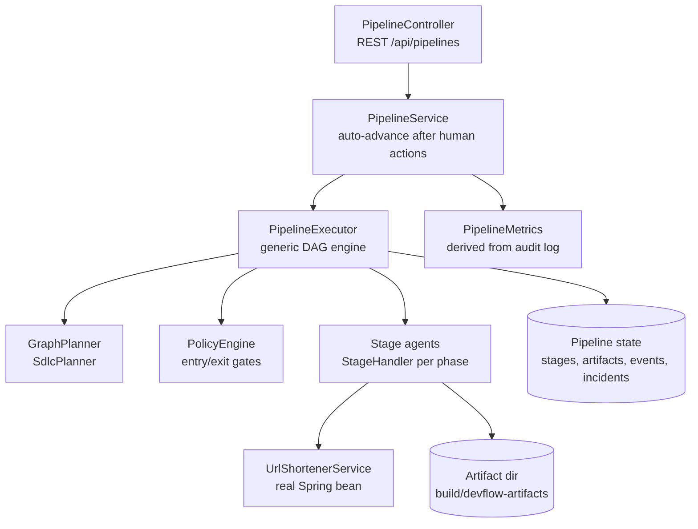
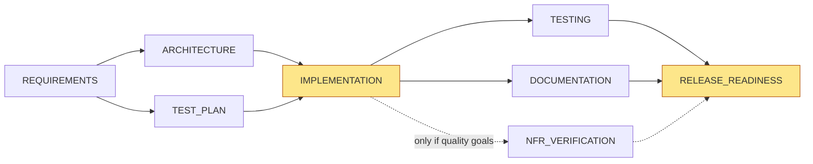
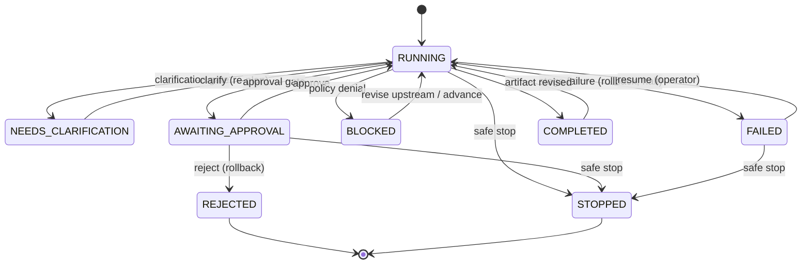

# Architecture and control model

## Components

| Component | Responsibility | Knows about URL shortener? |
|---|---|---|
| `PipelineExecutor` | Scheduling, parallel waves, joins, gates, retries, rollback, safe stop, re-planning, invalidation | No |
| `PipelineGraph` | DAG validation, topological order, ancestors and descendants | No |
| `PolicyEngine` + rules | Declarative guardrails at entry and exit gates | No |
| `SdlcPlanner` | Derives the graph from the REQUIREMENTS artifact | Only SDLC stage names |
| Stage agents (`orchestration/sdlc`) | Domain work for one phase each | Yes |
| `PipelineMetrics` | Reliability metrics computed only from events | No |

Adding a stage means one `StageHandler` plus one line in the planner. The executor is not touched.

## Lifecycle graph (greenfield and brownfield)

Highlighted stages have a human approval gate. When the requirement is ambiguous, the planner first produces only `REQUIREMENTS → CLARIFICATION` (a human-input gate). After clarification, the requirement is re-analysed and the graph is re-planned into the shape above.

## Control loop

Each `advance` runs this loop while holding the pipeline's lock:

1. **Re-plan.** Ask the planner for the desired graph given the current artifacts. If it differs from the current graph, apply the diff: new stages start PENDING, removed or redefined stages are compensated. The change is logged as `GRAPH_REPLANNED`.
2. **Ready set.** Select PENDING stages whose dependencies are all COMPLETED.
3. **Entry gate (policy).** Evaluate ENTRY rules. A denial sets the stage to BLOCKED, logs `STAGE_BLOCKED`, and lets the rest of the graph continue where possible.
4. **Human gate.** For `HUMAN_APPROVAL`, the stage runs only if an approval exists whose bound input digests equal the current ones; otherwise it waits in AWAITING_APPROVAL. For `HUMAN_CLARIFICATION`, the stage waits in AWAITING_INPUT.
5. **Wave execution.** The remaining ready stages run concurrently on a bounded pool (4 threads, 30 s timeout per stage) and are joined (`PARALLEL_JOIN`). Agents receive only a `StageContext` (the requirement plus versioned ancestor artifacts) and cannot mutate pipeline state.
6. **Exit gate (policy).** EXIT rules check the output. A denial counts as a stage failure, and any side effects of the rejected output are compensated.
7. **Publish.** Accepted output becomes an immutable `ArtifactVersion` carrying a version number, a SHA-256 content digest, and the input versions it consumed.
8. **On failure.** Start no new stages, skip all dependents, compensate completed side-effecting stages in reverse topological order, open an incident, and set the pipeline to FAILED (`PIPELINE_HALTED`).
9. The loop repeats until nothing is runnable. The pipeline status is then derived from the stage statuses.

### Pipeline states

## Governance

### Human checkpoints

| Gate | Why it is high impact | Bound to |
|---|---|---|
| IMPLEMENTATION approval | Authorises code change against the reviewed design and test plan | Content digests of REQUIREMENTS, ARCHITECTURE, TEST_PLAN |
| RELEASE_READINESS approval | Release sign-off | Digests of all upstream evidence |
| CLARIFICATION | Agents must not invent intent | n/a (human supplies text) |

**Change control by digest.** An approval records the content digests of every input the reviewer saw. If an input later changes materially, for example because an architect revises the design, the approval is invalidated (`APPROVAL_INVALIDATED`) and must be given again. A re-run that reproduces byte-identical evidence, such as regenerated documentation after recovery, keeps its approval. This avoids rubber-stamp loops without weakening the control.

**Segregation of duties.** Reserved agent identities (`agent`, `system`, `orchestrator`, …) cannot approve, resume, or stop.

### Policy rules

| Rule | Category | Gate | Effect |
|---|---|---|---|
| SEC-001 no secrets in artifacts | Security | EXIT (agent and human revisions) | Output containing credential-like patterns is rejected |
| SEC-002 artifact write location | Security | EXIT | Files may only be written inside the artifact directory |
| CHG-001 change-set scope | Change control | EXIT | Proposed changes may only touch `url` source/test packages and `docs/`; `pom.xml`, `.github/` and `application.properties` are never allowed |
| CMP-001 release requires verified evidence | Compliance | ENTRY of RELEASE_READINESS | Every upstream verdict must be PASSED; BLOCKED evidence can never be released |

Every evaluation is logged (`POLICY_ALLOWED` / `POLICY_DENIED`) with the rule id, category and reason.

## Reliability controls

| Control | Mechanism |
|---|---|
| Bounded retry | Per-stage `maxAttempts`; only `TransientStageException` is retried (data-access transients are mapped to it by `ServiceProbe`); linear backoff; every retry logged |
| Timeout | 30 s per stage; a timeout counts as failure |
| Rollback | `StageHandler.compensate`; DOCUMENTATION deletes its generated file; TESTING and NFR clean up their own fixtures in `finally` |
| Safe stop | Automatic halt on failure; operator `stop` is terminal; execution budget of 40 stage runs per pipeline prevents runaway re-plan loops |
| Recovery | `resume` re-queues FAILED, SKIPPED and ROLLED_BACK stages; when the pipeline completes, the incident is closed and MTTR is recorded |

## Observability

Every state change appends a sequenced event (`seq`, `type`, `stageId`, `actor`, `details`, `timestamp`). `actor` distinguishes `agent:<PHASE>`, `orchestrator`, `planner:*`, `policy-engine`, and named humans, so the log answers "who decided what, based on which inputs".

| Metric | Definition |
|---|---|
| `stageSuccessRatePercent` | STAGE_COMPLETED / (STAGE_COMPLETED + STAGE_FAILED) |
| `retryCount`, `rollbackCount` | Count of STAGE_RETRY and ROLLBACK_COMPLETED |
| `mttrMs` | Mean of (RECOVERY_COMPLETED − first STAGE_FAILED) per incident |
| `endToEndLatencyMs` | createdAt → PIPELINE_COMPLETED |
| `humanWaitMs` / `agentLatencyMs` | Time spent waiting at gates vs the remainder; shows where lead time actually goes |

## Key decisions and trade-offs

1. **The plan is derived, not declared.** The graph is a function of artifacts, so re-planning is one mechanism rather than special cases. The cost is that the planner must be deterministic and fast; it is.
2. **Agents are pure functions of context.** This makes them unit-testable and safe to run in parallel. Side effects must be declared and compensable.
3. **BLOCKED is a first-class verdict.** It separates "failed" from "cannot be verified", which is what prevents false passes on vague quality goals.
4. **Digest-bound approvals rather than version-bound.** This is stricter than "approved once" and kinder than "any re-run invalidates".
5. **Deterministic analysis over an LLM by default.** Results are reproducible and testable. An LLM could improve recall on unusual phrasing, behind the same contract, with the existing gates still applying.
6. **In-memory pipeline state.** This kept scope to one day. Because every state change is already an append-only event and artifacts are immutable, the natural next step is an event-sourced store: persist events and artifacts, then rebuild pipeline state by replaying them on startup.
